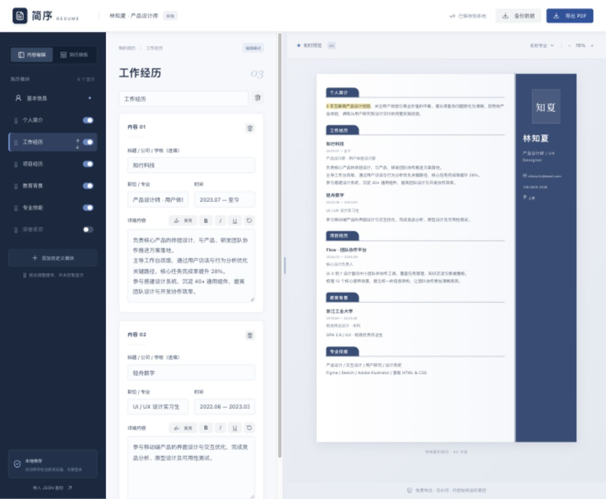
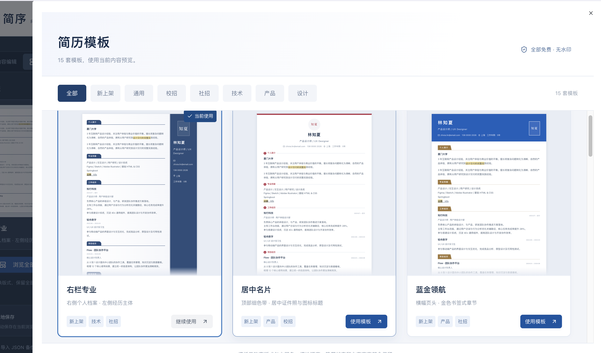
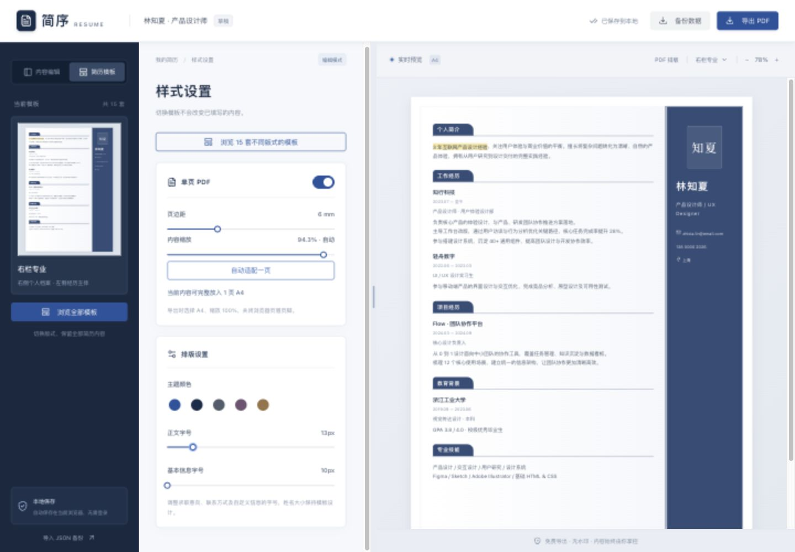

# 简序 · Size Resume

React + TypeScript + Arco Design 的轻量简历编辑器，后端尚未接入。

## 项目截图

以下截图使用示例简历展示主要功能。

### 内容编辑与实时预览

左侧管理模块，中间编辑内容，右侧实时预览。支持文字高亮、加粗、斜体、下划线，以及拖动分隔条调整编辑区宽度。



### 模板选择

内置 15 套不同版式，支持分类筛选。点击卡片或「使用模板」即可切换，保留已填写的简历内容。



### 单页 PDF 排版

支持调节页边距和内容缩放，也可自动适配一页；预览区同步展示排版效果。



## 运行

```bash
npm install
npm run dev
```

生产构建：`npm run build`。构建结果位于 `dist/`。

## 功能

- 编辑基本信息、经历、技能；添加自定义模块与多条经历。
- 基本信息可添加、编辑、删除自定义字段（名称 + 内容），如工作年限、个人网站；内容为空时不展示。自定义字段适用于全部模板，并随本地保存和 JSON 备份保留，兼容旧版草稿。
- 使用模块左侧拖拽柄排序，支持触屏；键盘聚焦拖拽柄后按空格、方向键、空格完成排序。也可使用悬浮显示的上下移动按钮。
- 开关控制模块是否出现在简历中，隐藏不删除内容。
- 在模块正文输入框中选中文字，可设置高亮、加粗、斜体、下划线，并可叠加；重复点击取消对应格式。“清除格式”清除选区格式，无选区时清除当前条目全部格式。格式同步到预览、本地保存和 JSON 备份；左侧编辑区直接显示实际格式，工具栏显示光标或选区的格式状态，输入时继承当前位置的格式。
- 15 套独立版式：右栏专业、居中名片、蓝金领航、几何新锐、黑白等高线、分栏履历、经典商务、蓝调双栏、职业时间轴、校招色带、技术极简、产品档案、弧线名片、现代管理、雅致书刊。模板库支持新上架及岗位分类筛选，用当前内容生成真实缩略预览；切换时应用模板默认配色，可继续调整主题色和字号。
- 可选上传个人照片（JPG、PNG、WebP，1MB 以内），随内容保存在当前浏览器和 JSON 备份中。技术极简版不展示照片。
- 编辑后 350ms 自动保存到当前浏览器 localStorage，关闭页面前再同步保存。仅保存在当前浏览器和当前站点；清理浏览器数据会删除本地副本，建议导出 JSON 备份。
- JSON 导入导出；导入会替换当前简历。
- PDF 按钮打开浏览器打印窗口，请选择“另存为 PDF”，建议关闭浏览器页眉页脚。长文自动分页，预览是连续 A4 宽度画布，不是分页模拟器。

## 数据与后端接入

数据模型定义在 `src/main.tsx`，本地存储键为 `size-resume.document.v1`。结构化内容与模板分离，`version` 用于后续数据迁移。接入 Spring Boot 时可将自动保存迁移到 API，并保留本地草稿机制。

当前示例内容仅用于演示，不会发送到服务器。书刊模板优先使用 Google Fonts 的 Noto Serif SC，无法加载时回退到本地衬线字体。

基本信息字号可在「简历模板 → 排版设置」中独立调整（10–20px），作用于联系方式及自定义字段，求职意向比该字号大 2px。设置随草稿与 JSON 备份保存，旧草稿保留各模板默认排版。

桌面端可拖动编辑区与预览区之间的分隔条调整宽度，刷新后保留。双击恢复默认；聚焦分隔条后可使用左右方向键调整，Shift 加速，Home / End 调至最小 / 最大宽度。窄屏保持编辑与预览切换。

## Single-page PDF

Use PDF layout in the preview toolbar, then enable single-page PDF. Margin (0-20 mm) and content scale (10-100%) are saved with the resume. Auto fit measures the full template and fits it inside one A4 page without deleting content. Manual overflow is flagged and blocks export. Printing uses the rendered template at the same scale; choose A4 portrait, 100% scale, and disable browser headers/footers. Disable single-page mode to keep the original multi-page print flow.
